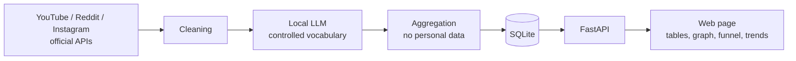

# market-intel

> Market and consumer intelligence from public comments, analyzed by a local LLM.

## What it is

A tool that turns **thousands of public comments** on YouTube (plus optional
Reddit and Instagram sources) into sentiment, themes, a word graph, an inferred
purchase funnel, trends over time and AI-written insights — using a **local
language model** (Ollama). All results are **aggregated and anonymous**: it never
profiles individuals.

It is the first build of **Ahab**, my hands-on path to becoming an AI engineer
(backend Python + AI).

## Why

Marketing teams guess what their audience thinks. The comments are already
public — the hard part is reading them at scale without paying for an API or
collecting personal data. A local model keeps the cost at zero and keeps the
analysis on the machine.

## Features

- **Search by topic:** a keyword → several videos → sentiment (👍/😐/👎) and
  themes from a controlled vocabulary. Sources: YouTube (default), Reddit and
  Instagram hashtags/business accounts (optional, official APIs only).
- **Analyze a video:** paste a URL → the video + ~5 related ones → tables
  (top words with per-word sentiment), word graph (bigrams), purchase-intent
  funnel, trends over time and AI-written insights.
- **Deep behavior mode:** more comments and same-channel videos, adding a
  polarization index, tone tags per video and the composition of the debate.
- History without re-running the AI, cache, JSON/CSV export, comparison of
  analyses, light/dark theme.

## How it works

## Stack

Python · FastAPI · Uvicorn · httpx · Ollama (qwen2.5) · SQLite ·
YouTube Data API v3 · Reddit API · Instagram Graph API · pytest (110 tests) ·
GitHub Actions CI

## What I learned

- Designing a small backend end to end: API clients → cleaning → AI analysis →
  aggregation → storage → HTTP API → web page.
- Using a local LLM with a **controlled vocabulary** so its output can be
  aggregated and tested, instead of free text.
- Staying within the law and the platforms' terms: official APIs, public data
  only, aggregated results, no personal data of third parties.
- Spec-driven development and an automated test suite that runs in CI on every
  push.

## Source code

The source code is private. It is available on request for hiring processes —
reach me through my GitHub profile.

---

🇧🇷 Inteligência de mercado a partir de comentários públicos, com IA local e resultados agregados e anônimos.

© 2026 Felipe Mendes. All rights reserved.
